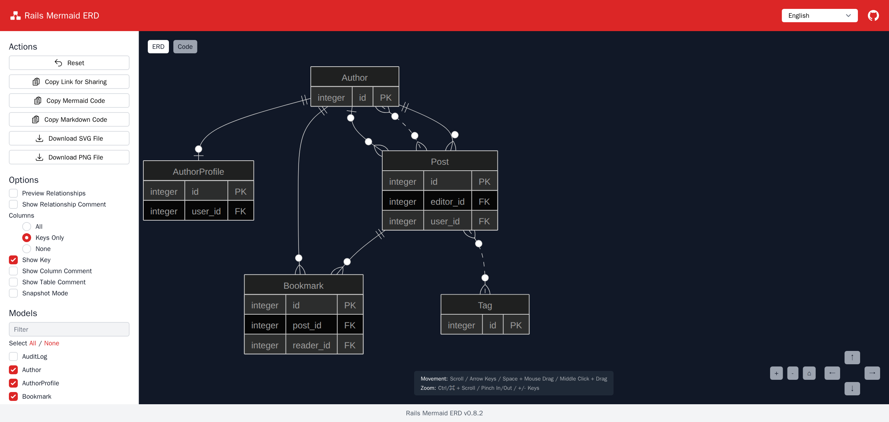

[English](./README.md) | [日本語](./README.ja.md) | [简体中文](./README.zh-CN.md) | [繁體中文](./README.zh-TW.md) | [한국어](./README.ko.md) | [Español](./README.es.md) | [Français](./README.fr.md) | [Deutsch](./README.de.md) | [Italiano](./README.it.md) | [Português (Brasil)](./README.pt-BR.md) | [Русский](./README.ru.md) | [العربية](./README.ar.md)

> Esta es una traducción del [README en inglés](./README.md). En caso de divergencia, la versión en inglés es la autoritativa.

<div align="center">

# Rails Mermaid ERD

**Genera un ERD de Mermaid interactivo de tu aplicación Rails como un único archivo HTML autocontenido.**

<a href="https://koedame.github.io/rails-mermaid_erd/example.html"></a>

[](https://github.com/koedame/rails-mermaid_erd/actions/workflows/run-test.yml)
[](https://rubygems.org/gems/rails-mermaid_erd)


[Página de demostración](https://koedame.github.io/rails-mermaid_erd/example.html) · [Instalación](#instalación) · [Uso](#uso) · [Versiones compatibles](#versiones-compatibles) · [Configuración](#configuración)

</div>

Ejecuta `rails mermaid_erd` y obtén un único archivo HTML autocontenido con el esquema de tu aplicación Rails, sin gems ni servicios adicionales. Tailwind, Mermaid y Vue vienen incorporados, así que se abre sin conexión y detrás de un proxy corporativo. En el navegador eliges las tablas que quieras y las exportas como código Mermaid, SVG o PNG; para compartirlo, entrega el archivo HTML o súbelo a un servidor web.

## Características

- **Un solo archivo, nada más que instalar.** La salida es un único archivo HTML de unos 4 MB con Tailwind, Mermaid y Vue incorporados, así que se abre sin conexión y detrás de un proxy corporativo.
- **Dibuja solo lo que necesitas.** Selecciona modelos, muestra todas las columnas, solo las claves o ninguna, y añade comentarios y etiquetas de relación.
- **Exporta y comparte.** Copia el código de Mermaid o Markdown, descarga SVG o PNG, o copia un enlace que restaura tu vista.
- **Amplia compatibilidad con Rails.** La CI cubre de Rails 5.2 a 8.1 con Ruby 2.7 a 4.0.
- **12 idiomas.** El visor sigue el idioma del navegador, incluido el árabe, que se escribe de derecha a izquierda.

## Instalación

Añade esta línea al Gemfile de tu aplicación:

```ruby
gem "rails-mermaid_erd", group: :development, require: false
```

Luego ejecuta:

```bash
bundle install
```

Añade esta línea al Rakefile de tu aplicación:

```ruby
# Rakefile
require_relative "config/application"

begin
  require "rails-mermaid_erd"
rescue LoadError
  # Do nothing.
end

Rails.application.load_tasks
```

Colócala **antes** de `Rails.application.load_tasks`. La tarea se registra mientras se ejecuta `load_tasks`, así que un `require` situado después (por ejemplo, al final del archivo) falla con `Unrecognized command "mermaid_erd"`.

## Uso

Ejecutar la tarea rake `mermaid_erd` generará `<app_root>/mermaid_erd/index.html`.

```bash
bundle exec rails mermaid_erd
# or
bundle exec rake mermaid_erd
```

Simplemente abre el archivo generado `<app_root>/mermaid_erd/index.html` en tu navegador.

Este archivo no es necesario para la gestión de Git, por lo que puedes añadirlo a `.gitignore` si es necesario.

```.gitignore
mermaid_erd
```

`<app_root>/mermaid_erd/index.html` es un único archivo HTML autocontenido. Todas las dependencias de front-end (Tailwind, Mermaid, Vue) están incluidas en línea, por lo que funciona sin conexión y detrás de proxies corporativos estrictos — no se necesita acceso a CDN al visualizarlo. El archivo pesa aproximadamente 4 MB porque los bundles se incluyen dentro de él.

Si compartes este archivo, puede ser usado por quienes no tengan un entorno Ruby on Rails. O bien, puedes subir el archivo a un servidor web y compartirlo con la misma URL.

El archivo generado contiene el esquema de su aplicación, incluidos los nombres de tablas y columnas y los comentarios. Compártalo o alójelo solo con el mismo alcance con el que compartiría el propio esquema.

Sería muy inteligente generarlo automáticamente usando CI.

### Imprimir el código fuente de Mermaid en stdout

Ejecuta la tarea rake `mermaid_erd:print` para imprimir el código fuente `erDiagram` en stdout en lugar de escribir el visor HTML. Esto se puede redirigir fácilmente a otras herramientas:

```bash
bundle exec rails mermaid_erd:print
bundle exec rails mermaid_erd:print > er.mmd
bundle exec rails mermaid_erd:print | mmdc -i - -o er.svg
```

La salida es el diagrama completo — cada tabla, columna, clave, comentario y relación — equivalente al visor HTML con todos los controles de detalle activados.

## Idiomas

La interfaz del visor viene en 12 idiomas: English, 日本語, 简体中文, 繁體中文, 한국어, Español, Français, Deutsch, Italiano, Português (Brasil), Русский, y العربية (de derecha a izquierda). Detecta automáticamente el idioma del navegador (`navigator.language`) al cargar, utiliza inglés como alternativa para idiomas no admitidos, y puede cambiarse manualmente desde el selector en la esquina superior derecha.

## Versiones compatibles

Las combinaciones de Ruby × Rails verificadas por CI en cada push y pull request:

| Rails | Ruby                             |
| ----- | -------------------------------- |
| 5.2   | 2.7                              |
| 6.0   | 2.7, 3.0                         |
| 6.1   | 2.7, 3.0, 3.1, 3.2, 3.3          |
| 7.0   | 2.7, 3.0, 3.1, 3.2, 3.3          |
| 7.1   | 3.1, 3.2, 3.3, 3.4               |
| 7.2   | 3.1, 3.2, 3.3, 3.4               |
| 8.0   | 3.2, 3.3, 3.4, 4.0               |
| 8.1   | 3.2, 3.3, 3.4, 4.0               |

Otras combinaciones pueden funcionar, pero no están verificadas.

## Configuración

Usa `./config/mermaid_erd.yml` para personalizar la configuración.
Consulta [./docs/example.yml](./docs/example.yml) para ver un ejemplo de configuración.

Los parámetros de configuración son los siguientes.

| clave | descripción | predeterminado |
| --- | --- | --- |
| `result_path` | Destino de los archivos generados. | `mermaid_erd/index.html` |
| `ignore_tables` | Array de cadenas de expresiones regulares. Las tablas cuyo `table_name` coincida con algún patrón se excluyen del ERD generado, junto con cualquier relación que apunte a ellas. Es útil para excluir modelos de registro de auditoría, tablas eliminadas lógicamente o legadas, u otro ruido que no desees renderizar. Los patrones se compilan con `Regexp.new`, así que escapa las barras invertidas dentro de las cadenas YAML (p. ej. `"\\Aaudit_"`). | `[]` |
| `viewer_defaults` | Vista con la que se abre el visor cuando la URL no lleva un estado guardado, y a la que vuelve **Restablecer**; un enlace con su propio estado siempre tiene prioridad. `models`: array con los nombres de los modelos seleccionados al inicio (un nombre que no está en el ERD se omite con una advertencia al generar el archivo). `columns`: `all`, `keys` (solo claves primarias y foráneas) o `none`, las mismas opciones que "Columnas" en la barra lateral. Útil para abrir una aplicación grande con los modelos por los que se suele empezar. | `models: []` (sin selección), `columns: all` |

<!--
TODO:
## Contributing

Contribution directions go here.
-->

## Marcas registradas

Este proyecto no está afiliado a Rails, The Rails Foundation, el proyecto Mermaid ni Mermaid Chart Inc., y no cuenta con su respaldo ni patrocinio. Rails y Ruby on Rails son marcas registradas de David Heinemeier Hansson. Mermaid Chart Inc. ha registrado o solicitado las marcas MERMAID CHART y MERMAID en Estados Unidos. Las demás marcas son propiedad de sus respectivos titulares.

## Licencia
La gem está disponible como código abierto bajo los términos de la [MIT License](https://opensource.org/licenses/MIT).
